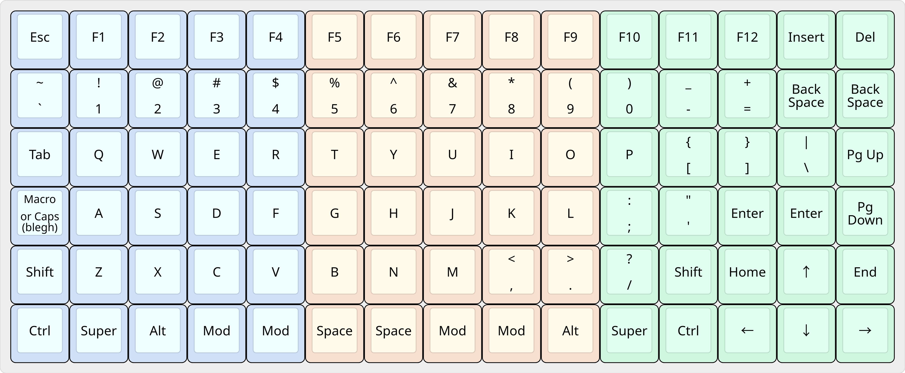
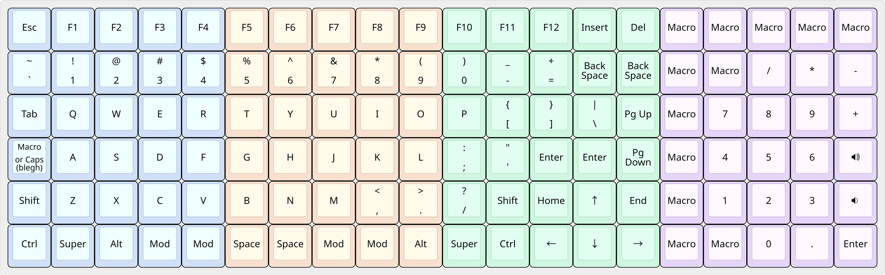
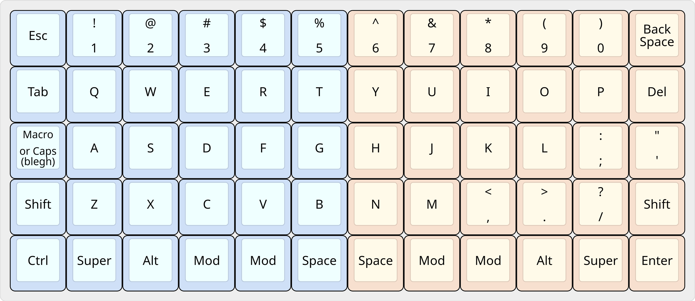

# Intertile Communication

## Identify
The modules need to communicate with each other, but how?

### Main (99% of the time) setup
Most of the time, for people that would actually use this, it would probably be in these layouts:

80% 3 tiles (portrait)

100% 4 tiles (portrait)

less common but still pretty common (in my estimate)
60% 2 tiles (landscape)

So i would like to keep 1000Hz polling+good latency for setups with less than 5 tiles.

### Info That Needs to Be Sent out from Central
- Keypress actuation point
- RGB instructions
- Firmware updates
- PD gates
- Tile coordinate/slot assignment
- Frame sync
- "release your keys" / reset

### Data That Needs to Be Sent to Central
- Key presses
- Where/how many tiles there are
- PD negotiation from peripherals
- Submodules what and where
- Errors/Faults
- PD Edge switch states
- 'I'm alive ദ്ദി(˵ •̀ ᴗ - ˵ ) ✧'

### Bidirectional Data
- Submodule data
- Power Delivery partitioning

### Relevant constraints
- Sub-1 ms latency
- 1000Hz polling rate (can have others, but must support 1000Hz)
- N-key rollover
- Per-key RGB

### What has to be managed/controlled
- USB-HID stack
- Inter-tile UART (PIO)
- Submodule UART (hardware+PIO)
- Power delivery PHY I2C
- Mux select+ ADC input

### Hardware locked stuff
- 4 full-duplex links per tile
- garbage frames on hot unplug
- 1000 Hz is max rp2350 usb speed

---

## Brainstorm

### latency

Originally (in [comms](../design-choices/comms.md#the-latency-problem)) i estimated latency with per-hop wire time times number of hops: *"0.12ms/hop × 4 hops = 0.48ms"* now that the hardware is finalized it is no longer accurate.

The thing is that it all depends on the tile layout. by design, a tile (specifically central) can receive data from all 4 (only 3 if central because of the usb) at the same time, so for larger arrays this can be taken advantage of via the central creating a 'data-flow map' on discovery. it should avoid merges unless absolutely necessary as that has costs. 

But, most of that doesn't matter because like 99% of the time, layouts will be 1 row so there is no fancy path to make, and no merges

### data flow path thingy

so like idk im just a girll™

i can think harder about that later

### how should communication happen (╭ರ_•́) (scheduling)

|                | how it works                                                      | why not                                   |
| -------------- | ----------------------------------------------------------------- | ----------------------------------------- |
| **Polled**     | central asks, peripheral answers                                  | simple, but slow and ineffesent           |
| **Autonomous** | just say stuff whenever                                           | not consistant, needs 'store and forward' |
| **Scheduled**  | central assigns each peripheral a window where it gets a 'talking stick' | needs 'global' clock of some sort         |

### how is data sent to central? (upstream)

Ive been thinking in the back of my head from the start that if we do some sort of 'frame' or 'window' type thing then that would avoid the problem of colliding data and that makes stuff a lot faster if we don't need to worry about it.

options: 
- relay each received bit from down stream as it arrives (when not in its own 'window')
- relay each byte as it is received (can count bytes for timer)
- 'store and forward' aka relay a 'frame' at a time

### how is data sent to peripherals (down stream)
This data is probably not very time sensitive, it can afford 'store and forward', i see a few ways of doing it:
- Central puts address at front, and any data received from central is read by each tile on the way and if 'this message isn't for me' then it will continue down the path, if 'this message is for me' then it doesn't continue.
- Same as above but sent to every tile every time
- Same frame/window method as 'send to central' data, but this time it's the other way and would have to be sent to every tile
- Frame method, but only relay frames that need to be relayed further

### What data is sent upstream every frame?

| Data                 | priority | notes                                                                                             |
| -------------------- | -------- | ------------------------------------------------------------------------------------------------- |
| Key presses          | 10       | normalized, digital                                                                               |
| per key analog value | 7        | normalized                                                                                        |
| slot                 | 6        | assigned during discovery then infured via timing                                                 |
| general status       | 8        | 'I'm alive ദ്ദി(˵ •̀ ᴗ - ˵ ) ✧' any (power) sense info, firmware version, pd gate(s) status, etc. |
| submodule info       | 9        | like input devices and stuff (ex. rotery encoder)                                                 |
| envelope             |          | sync, flags, etc.                                                                                 |

### What baud speed?
depends on what data needs to be sent:
the raw size of data being sent upstream

| data                                             |  bytes |                                                        |
| ------------------------------------------------ | -----: | ------------------------------------------------------ |
| key presses                                      |      4 | 30 bits                                                |
| per key analog                                   |     30 | 30 × ~~12-bit~~ 8 bit is standard for analog keyboards |
| slot                                             |      0 | position in the frame is the slot                      |
| general status                                   |      3 | one rotating register per frame                        |
| submodule info                                   |     13 | length byte + payload (probably for all 4)             |
| envelope                                         |      5 | sync, flags, counter, CRC16                            |
| something else i will  realize i forgot later |      9 | mainly buffer and 64 total is nice number              |
| **total**                                        | **64** | plus whatever there is room for                        |

rapid trigger is run locally per tile so it can scan way faster than 1kHz and run debounce stuff or whatever.

**5(-1 (Central)) × 64 = 256 B per period**

PIO divides the 150MHz system clock by whole cycles per bit, and it has to be whole
options:

| cycles/bit |    baud | 256 B takes |
| ---------: | ------: | ----------: |
|          8 | 18.75 M |      137 µs |
|         16 | 9.375 M |      273 µs |
|         32 | 4.688 M |      546 µs |
I want to pick the fastest stable option (for scalability)

#### Ringing and series termination
uart trace lengths(2D mm):

| Connection |     Tx |     Rx |
| ---------- | -----: | -----: |
| N          |  38.48 |  40.93 |
| E          | 129.43 | 158.73 |
| S          |  92.92 | 107.27 |
| W          |  52.13 |  60.13 |

Longest link is a flipped neighbour on E: 129.43 Tx + 158.73 Rx = ~288 mm.
Main use cases:
E: 129.43 Tx + W: 60.13 Rx = ~190 mm
W: 52.13 Tx + E: 158.73 Rx = ~211 mm
The longer paths are also the main use case paths. *Yippee.* ✺◟(¬_¬)◞✺

ngl a lot of this is just 'does it work in practice' so ill just have to test it

## Select

### upstream data

i do some ~~meth~~ maths for these:

|          |     per hop | window, 5 tiles |
| -------- | ----------: | --------------: |
| bit      |       ~7 ns |          273 µs |
| **byte** | **1.07 µs** |      **277 µs** |
| frame    |       68 µs |          546 µs |
byte gains clean regenerated data every hop, byte counting (free clock/sync) and only loses ~4µs vs bit relaying and gains that back with (probably) more reliable data stream.
frame was never really a option cuz it sucks and is slow and yeah.
### scheduling

- Polled
	round trip per tile, scales horribly
- Autonomous
	better, but would requires storing frames for collisions
- Scheduled
	needs global clock, but best latency and efficient

Autonomous gone cuz it needs storing (already shot down), polled.... just *bleh*. 
The only real option **Scheduled**

### downstream

- address, consume data
	don't send more unnecessary data downstream
- address, relay every time
	one path for every frame, less to get wrong
- window method, reversed
	every tile all the data, specific frames for specific tiles, (probably have a all frame)
- only relay frames that need it
	doent really gain much

unlike what i originally thought relaying further doesn't really cost anything (all pio), so its between address, and frames. since we are already going to have to make a scheduler might as well make both the same.
**Scheduled frames**

### baud rate

i want the highest one that is consistent/stable, which is a different question.

|             |        bit | sample at |           early margin |
| ----------- | ---------: | --------: | ---------------------: |
| 18.75 M     |      53 ns |     27 ns |     17 ns = 2.5 cycles |
| **9.375 M** | **107 ns** | **53 ns** | **43 ns = 6.5 cycles** |
| 4.688 M     |     213 ns |    107 ns |    97 ns = 14.5 cycles |

18.75 saves 137 µs out of 1000 vs 9.375. basically irrelevant; USB caps at 1kHz so there's not much to gain. 

I can probably test 18.75 later, 9.375 is enough/safe.

**9.375 Mbaud, 16 cycles/bit.**

