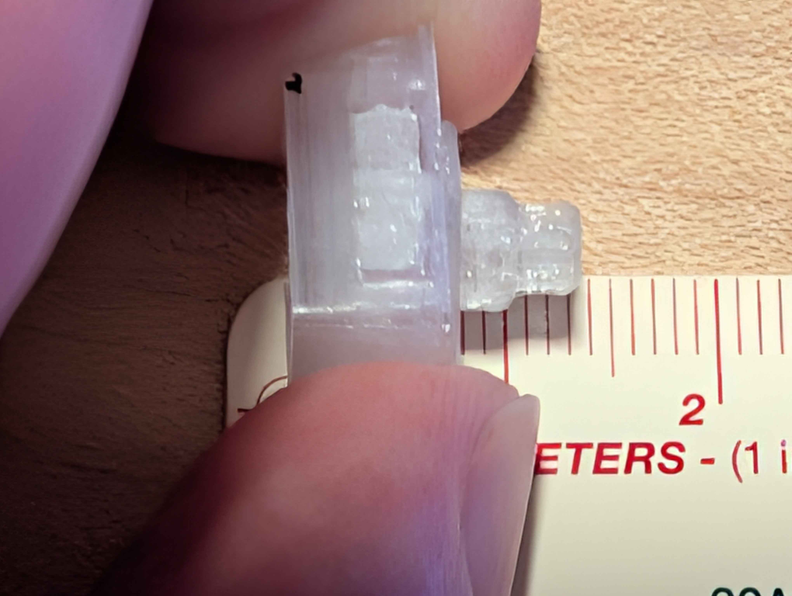

# Switches
the... keyboard switches ╮(─ω─)╭

## Identify
I need to make actual working switches

How? 
Void switches (decided on [here](../design-choices/switches.md))

so really the step is
## Implement
but really it is 
## Repeat
cuz i need to figure out the best way to go about this.

### Previous experience/tests
I have tryed to print good void switches a number of times in the past, and only occasionally actually made *good* ones. i need to dial in the 'settings' for printing these

### Starting point
riskable's low-profile 'defaults' are these:
- N52 4×1mm magnets, no levitator, ~2mm travel
- 8mm tall switch
- 2mm tall keycap stem
- 0.2mm (1 layer) wall between the magnets is enough, some will fail tho (printing or tearing it when inserting the magnet)

(Credit [Riskable](https://github.com/riskable))

### Height budget
In some testing ive done (undocumented) i came up with this:

| Part                  | mm        |
| --------------------- | --------- |
| Keycap past stem      | 2.25      |
| Void switch           | 7.0       |
| Hall sensor           | 1.4       |
| PCB                   | 1.6       |
| Bottom case           | 1.0       |
| **Subtotal**          | **13.25** |
| Stem travel (~2mm)    | +2        |
| **Total**             | **15.25** |

Don't remember the settings tho, and i am sure they weren't 'optimal' anyway so doing *this* is better

## Identify
What 'tuneable' parameters are there?
What testing method?

### Variables
#### Printer
##### Physical
- Printer type (FDM or resin)
- Printer model
- Nozzle size
- Bed surface

##### Slicer settings
- Tune filament first
- Layer height
- Cooling / fan speed
- Print speed
- Dimensional compensation

##### Material
- Filament (plastic) type
- Filament brand
- Filament dryness
- Color (and opacity)
- Lubricant

#### Switch generation parameters
(independent/dependent relative other variables besides 'does it work well')
##### Independent
- Magnet size
- Magnet polarity and orientation
- Travel distance
- Overall switch height (low profile target)

##### Mostly independent
- Stem size
- Stem tolerance

##### Depends on other parts
- PCB mounting and retention (need to do [chassis](chassis.md))
- Keycap interface (depends on [keycaps](keycaps.md))

## Brainstorm
how do i test each parameter, and what parameters are 'base' ones

### General method
- Change one variable at a time, print a batch
- Choose order that means the base is stable
- *Document* the results (crazy, i know)

#### What 'good' means
- Moves smoothly, no binding
- Returns ***every*** time
- ~80%+ of a 'batch' turns out 'good'

#### Printer
| Parameter            | What do i have?                                                                                                 |
| -------------------- | --------------------------------------------------------------------------------------------------------------- |
| Printer type / model | Voron 2.4 350mm$^3$, Anycubic photon mono x2 (i think thats the name), flash-forge AD5 (not mine but i can use) |
| Nozzle size          | (e3d revo nozzels for voron) 0.6mm 0.4mm 0.25mm 0.15mm                                                          |
| Bed surface          | smooth and textured (i like smooth better ⁽ ⁽ ( ⏑‿⏑ ) )                                                         |

#### Slicer settings
| Parameter                | Base?    | How to test                                                                                |
| ------------------------ | -------- | ------------------------------------------------------------------------------------------ |
| Filament tuning          | Yes      | temp tower, flow, retraction                                                               |
| Layer height             | yes      | batch at a few heights, check stem fit and the wall                                        |
| Cooling / fan speed      | no       | batch, look for warping and layer bonding                                                  |
| Print speed              | no       | batch, look for dimensional error                                                          |
| Dimensional compensation | a little | print stem/housing test pieces, measure with calipers, adjust until the clearance is right |

#### Material
| Parameter           | Base?    | How to test                                         |
| ------------------- | -------- | --------------------------------------------------- |
| Filament type       | Yes      | same switch in each type, compare friction and wear |
| Filament brand      | a little | same as above, lower priority                       |
| Filament dryness    | a little | dry vs not dry, same settings                       |
| Color (and opacity) | ehhh     | check how the light looks through it                |
| Lubricant           | no       | with vs without, compare feel                       |

#### Switch generation parameters
| Parameter                     | Base?             | How to test                                                        |
| ----------------------------- | ----------------- | ------------------------------------------------------------------ |
| Magnet size                   | yes               | one of each in the same switch, compare force and ADC range        |
| Travel distance               | mostly, ~2mm      | only change if the signal or feel needs it                         |
| Overall height                | mostly, 15mm goal | check against the height budget                                    |
| Stem size                     | not really        | print a few sizes, keep the smallest that still works              |
| Stem tolerance                | no                | print a few clearances, pick the one with no wobble and no binding |

### Test plans
three ways to go about it, pick one (or mix) in the next section.

### Plan A: one variable at a time
Slow and careful, the base gets stable before anything else is touched.

#### Phase 1: get the plastic working (no magnets, no sensor)
Small coupons or stripped down switches, they print fast and dont waste magnets.
1. **Printer + nozzle:** Voron with the 0.25mm nozzle (a 0.2mm wall is thinner than a 0.4mm line). Try 0.15mm later if the wall is the problem. Resin is skipped for now.
2. **Filament type:** try one or two (PETG, PLA). Material changes shrinkage and friction, so everything below gets redone if it changes.
3. **Filament tuning:** temp tower, flow, retraction.
4. **Layer height:** coupled to the wall (0.2mm wall = 1 layer only at 0.2mm layers). Check stem fit and the wall.
5. **Dimensional compensation:** print test pieces, measure with calipers until the printed sizes match the design.
6. **Stem tolerance:** print 4 or 5 clearances, keep the one with no wobble and no binding (stem falls through under its own weight).

#### Phase 2: baseline switch
7. Print the full switch with riskable's defaults (4×1mm N52, 0.2mm wall, ~2mm travel). Print 10, count the 'good' ones (8+ hits the 80% goal).
8. Log the ADC while pressing a few of them. Is the signal usable and consistent?

#### Phase 3: the less important stuff
Only once the baseline works, one per batch:
9. Magnet size (3×1, 4×1, 4×2), judged by feel and ADC range
10. Stem size, down toward 2mm
11. Cooling and print speed
12. Filament dryness, then brand, then lubricant (last because it can hide a bad print)

### Plan B: batch plates
Print a bunch of variants on one plate (a few clearances × a couple of layer heights), then look at all of them at once.
1. Do filament type + filament tuning first (same as plan A, these affect everything)
2. Plate 1: stem tolerance × layer height, full switch without magnets
3. Pick the best combos, then plate 2: dimensional compensation × print speed
4. Add the magnets to the best few, check feel and ADC
5. Magnet size, stem size, and the Phase 3 stuff one at a time like plan A

Faster (fewer print sessions), but harder to tell *why* something is good since two things changed at once.

### Plan C: 'i think this should work', then fix what breaks
1. Pick the settings i think will work (filament, 0.25mm nozzle, layer height, tolerance, compensation) from what i already know and riskable's switch (his magnets, wall, travel), and write them down
2. Print a batch of 10 and see how it does
3. Look at *how* the bad ones fail (stem binds, wall tears, loose, weak return)
4. Change only the setting that targets that failure
5. Repeat until ~80%+ are good

Quickest way to a working switch, and it uses what i already know, but the first guess could be way off, it can stall on a failure that has several causes, and the settings i end up with might not be optimal.

## Select

| Criteria                              | Weight | A: One at a time | B: Batch plates | C: Educated guess, fix what breaks |
| ------------------------------------- | :----: | :--------------: | :-------------: | :--------------------------------: |
| Time to a working switch              |   6    |        2         |        6        |                 8                  |
| Know *why* it works                   |   5    |        9         |        4        |                 5                  |
| Settings end up close to optimal      |   5    |        8         |        6        |                 4                  |
| Easy to document                      |   4    |        8         |        5        |                 6                  |
| **Weighted Total**                    |        |       141        |       121       |                135                 |
Winner: One at a time